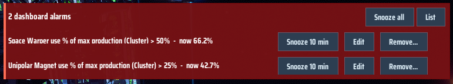
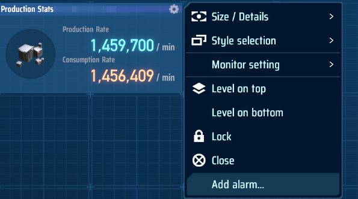
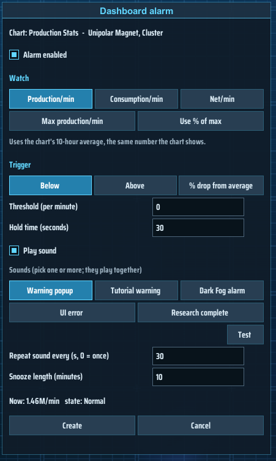

# Dashboard Alarms

Alarms for the Dyson Sphere Program **Dashboard**. Pick a production or storage chart, set a rule,
and the mod warns you when it breaks, with a flashing chart border, a banner at the top of the
screen and a sound. The banner and sound work even when the Dashboard is closed.

Example: *"Warn me when Space Warper demand reaches 90% of what my warper factories can make."*

**The alarm banner** lists every alarm with its current value. It shows even when the Dashboard is
closed.



**Add an alarm** from any production or storage chart's menu, then set it up in the alarm window.





## Features

- **Watch** production, consumption, net, **max production** or **use % of max** on item production
  charts, and total stock on item storage charts.
- **Trigger** when the value is above or below a number, or when it drops a set % below its recent
  average.
- **Hold time** so short dips don't set it off.
- **Alerts:** a flashing chart border, a banner listing every alarm, and one or more of the game's own
  sounds. They play even with the game's sound turned off, if you want that.
- **Snooze** silences an alarm for a set time. There's no permanent mute, so an alarm can't be
  silenced and forgotten.
- **Saved** with each save file.
- **Styled** to match the game's UI.

## Install

Install from [Thunderstore](https://thunderstore.io/c/dyson-sphere-program/p/buffy5490/DashboardAlarms/) with **r2modman** (or the Thunderstore app). BepInEx and DSPModSave are installed with it
automatically.

To install by hand, copy `DashboardAlarms.dll` to `BepInEx/plugins/DashboardAlarms/`. You also need
BepInEx 5 and [DSPModSave](https://thunderstore.io/c/dyson-sphere-program/p/CommonAPI/DSPModSave/).

## Using it

1. Open the Dashboard and add an item production or item storage chart the normal way.
2. Open the chart's menu and choose **Add alarm...** at the bottom.
3. Pick what to watch, the trigger, the threshold, the hold time and the sounds, then press **Create**.
4. To change or delete it later, choose **Edit alarm...** from the same menu.

**Ctrl+Shift+A** opens a list of every alarm. From the list you can turn alarms on or off, edit them
or delete them.

Each alarm covers the same area as its chart. Set the chart to the whole cluster to watch every
planet.

## What you can watch

| Chart | Watch |
|---|---|
| Item production | **Production/min**, **Consumption/min**, **Net/min** (production − consumption), **Max production/min**, **Use % of max** |
| Item storage | **Stock**: total items in every storage category the chart shows |

- **Rates** use the chart's own time setting (1 minute, 10 minutes, 1 hour, ...), so the alarm sees the
  same number the chart shows. A chart set to "total" uses 1 minute.
- **Max production** is the game's reference rate: the most that every powered machine making the item
  can output per minute, counting proliferator. It's the "reference speed" in the game's statistics
  tooltips. It stays steady when output is held back by full belts or low demand.
- **Use % of max** is consumption ÷ max production, so it shows how close demand is to what your
  factories can make. For example, Space Warper, Use % of max, Above 90.

## Triggers

- **Below**: fires when the value is under a number, for example white science production < 300k/min.
- **Above**: fires when the value is over a number, for example hydrogen stock > 5M.
- **% drop from average**: fires when the value falls a set % below its own recent average. While a
  drop is happening the average stays frozen, so a long drop keeps alarming. **Reset average**
  accepts the new level as normal.

Every alarm has a **hold time**: the rule has to stay broken for that many seconds before the alarm
fires. Number fields accept `300000`, `300,000`, `300k`, `1.5M` and `2G`.

## When an alarm fires

- **Chart border:** flashes red on the Dashboard. It's amber while the hold time is running.
- **Banner:** a red banner at the top of the screen lists every alarm and its current value.
- **Sound:** the sounds you picked play together, and repeat every N seconds if you set a repeat
  interval.

Each banner line has three buttons:

- **Snooze**: silences that alarm for its snooze length. It stays in the banner, dimmed, with a
  countdown.
  - If the value recovers during the snooze, the alarm clears.
  - If it's still bad when the snooze ends, the alarm sounds again.
  - **Unsnooze** ends the snooze early.
- **Edit**: opens the alarm's settings.
- **Remove...**: deletes the alarm after you confirm. The chart stays on your Dashboard.

**Snooze all** appears when two or more alarms are going off. **List** opens the alarm list.

## Settings

In the game's **Settings > Audio** tab:

- **Dashboard alarms play with sound off** (on by default): alarms play even when the game's master or
  sound effects volume is down or off. Turn it off to have alarms follow the game's volume instead.
- **Dashboard alarm volume** (default 50%), with a **Test** button.

Other options are in `BepInEx/config/buffylvr.dsp.dashboardalarms.cfg`:

| Setting | Default | Meaning |
|---|---|---|
| `General.SampleSeconds` | 2 | How often each alarm checks its chart's value. |
| `General.StockRefreshSeconds` | 30 | How often stock and max-production alarms ask the game to recount. The game counts one planet per tick, so a lower number costs more CPU on very large saves. Minimum 5. |
| `Sound.AlarmVolumePercent` | 50 | Alarm volume, the same as the Settings slider. |
| `Sound.PlayWithSoundOff` | true | The same as the Settings checkbox. |
| `UI.Scale` | 1 | Size of the alarm windows and banner. |
| `UI.AlarmListHotkey` | Ctrl+Shift+A | Opens and closes the alarm list. |

## Notes

- Only item production and item storage charts can have alarms for now. Power, Dyson sphere and other
  charts can't yet.
- **Storage counts:** the game only counts storage and machines when something asks, so the mod asks
  for a recount every `StockRefreshSeconds`. Stock and max-production alarms therefore update every 30
  seconds by default.
- **Deleted charts:** if you delete a chart's stat plan, its alarm is deleted too.
- Tested on game version 0.10.35.29151.

Report bugs and ideas at <https://github.com/Buffylvr/DSPDashboardAlarms/issues>.

## Building from source

```
dotnet build -c Release
```

The build references DLLs from your game folder and your BepInEx profile, and none of those DLLs
are in this repo. The default paths are the Steam install location and the r2modman `Default`
profile. To use other paths, create a `Directory.Build.user.props` file (it's git-ignored):

```xml
<Project>
  <PropertyGroup>
    <DSPDir>D:\SteamLibrary\steamapps\common\Dyson Sphere Program</DSPDir>
    <BepInExDir>$(APPDATA)\r2modmanPlus-local\DysonSphereProgram\profiles\MyProfile\BepInEx</BepInExDir>
  </PropertyGroup>
</Project>
```

Offline logic tests (no game needed):

```
cd tests/LogicTests && dotnet build -c Release && bin/Release/net472/DashboardAlarms.LogicTests.exe
```

`package.ps1` builds the Thunderstore zip into `dist/`.

## License

MIT
